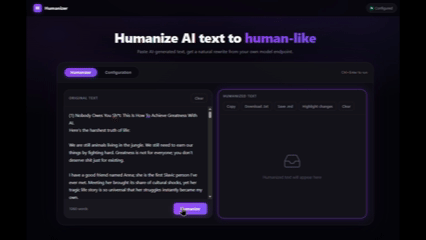

# Humanizer – local web app

A local web application that rewrites AI-sounding text into natural human prose, using your own OpenAI-compatible model endpoint. It applies the bundled [Humanizer skill](humanizer/SKILL.md) – 26 named "signs of AI writing" – through a **multi-pass pipeline** that gives the model scratch space, then verifies its own work.

No third-party dependencies. Runs on Python only.



## Features

- **Multi-pass humanization** – Scan → Rewrite → Check → Fix. The model first lists the AI tells it finds, rewrites from that list, then checks its own output; a **deterministic code check** also feeds back paragraphs copied word-for-word, so visible rewriting happens even on small models.
- **Status board** – spinner, current step ("Step 2 of 3 – rewriting from 13 found tells…") and elapsed timer, plus a scan animation over your text while the model works.
- **Edit intensity** – *Thorough* (multi-pass, deep) or *Light* (single pass, fixes only clear tells – good for text you wrote yourself).
- **Streaming output** – the rewrite arrives token by token, with liveness markers during silent waits.
- **Markdown safety net** – links, images, headings and lists are preserved; dropped images are restored automatically.
- **SSL escape hatch** – one toggle for VPNs and corporate proxies that break certificate verification.

## Quick start

Requires Python 3.10+ ([uv](https://docs.astral.sh/uv/) recommended, plain Python works too):

```powershell
# Windows
.\start.bat

# any OS
uv run python app.py
# or, without uv
python app.py
```

- Backend API: `http://127.0.0.1:8774`
- Web UI: `http://127.0.0.1:8775` (opens automatically)

Override ports with `--backend-port`, `--frontend-port`, `--host`, `--no-browser` (or `HUMANIZER_*` environment variables).

## Setup

1. Open the **Configuration** tab.
2. Fill in your endpoint:
   - **Base URL** – e.g. `https://integrate.api.nvidia.com/v1` (NVIDIA NIM), `https://api.openai.com/v1`, `http://localhost:11434/v1` (Ollama).
   - **API key** – stored as-is in `config.json` (plaintext; the file is gitignored).
   - **Model name** – see [Choosing a model](#choosing-a-model).
3. Tune the run:
   - **Temperature** (default 0.7) and **Max tokens** (default 4000).
   - **Disable reasoning** – asks supported endpoints to skip the thinking phase (reasoning models can otherwise burn the whole Max-tokens budget and return nothing).
   - **Edit intensity** – Thorough (default, multi-pass) or Light.
   - **Step-by-step rewriting** – the multi-pass chain described above (on by default for Thorough).
   - **Verify SSL certificates** – turn off on VPNs/corporate proxies that intercept HTTPS.
   - **Writing sample** (optional) – a few paragraphs of your own writing so the rewrite matches your voice.
4. **Save**, then **Test connection**.

Paste text, press **Humanize** (or Ctrl+Enter), watch the scan, copy the result.

## Choosing a model

Humanizing is a constrained-rewrite task: the model must hold 26 patterns in mind, rework whole sentences, and still preserve every fact, link and heading. Small or lightly-tuned models often return the input nearly unchanged.

**Tested on NVIDIA NIM** (`https://integrate.api.nvidia.com/v1`):

| Model | Notes |
|---|---|
| `deepseek-ai/deepseek-v4.1-flash` | **Known-good.** Deep rewriting (-153/+153 words on a 1k-word test), links and markdown preserved. Recommended default. |
| `nvidia/nemotron-3.5-lightning-30b-a3b` | Runs the pipeline but edits timidly (~1/10th the depth of DeepSeek). Works, best with *Disable reasoning* on. |
| `nvidia/nemotron-3-super-120b-a12b` | Larger Nemotron sibling – worth trying. |
| `writer/palmyra-creative-122b` | Creative-writing tuned; interesting for prose. |
| `openai/gpt-oss-20b`, `moonshotai/kimi-k2.6`, `mistralai/mistral-large-2-instruct` | Listed on NIM; availability varies per account. |

Works with **any** OpenAI-compatible endpoint: Ollama, LM Studio, llama.cpp server, OpenRouter, OpenAI.

Troubleshooting:
- `404` on a model → not enabled for your account; pick another.
- `504` → gateway timeout at the provider; retry or switch model.
- Empty output → a reasoning model spent the whole Max-tokens budget thinking; raise *Max tokens* or enable *Disable reasoning*.
- `CERTIFICATE_VERIFY_FAILED` → turn off *Verify SSL certificates* (VPN/proxy interception).

## Configuration

Settings live in `config.json` (created on first save; see `config.example.json`):

| Key | Type | Default | Purpose |
|---|---|---|---|
| `base_url` | string | – | OpenAI-compatible endpoint |
| `api_key` | string | "" | Bearer token (plaintext) |
| `model_name` | string | – | model ID |
| `temperature` | float | 0.7 | sampling temperature (`null` = model default) |
| `max_tokens` | int | 4000 | output budget (reasoning included) |
| `disable_reasoning` | bool | false | skip the thinking phase |
| `edit_intensity` | "thorough"/"light" | thorough | rewrite depth |
| `verify_ssl` | bool | true | TLS verification |
| `multi_pass` | bool | true | scan → rewrite → check → fix chain (Thorough) |
| `writing_sample` | string | "" | voice matching |

## Security

Single-user, local-only by design (binds to `127.0.0.1`). Your text and API key leave the machine only toward the endpoint you configure. The key is stored in plaintext in `config.json` – do not commit or share that file.

## License

MIT – see [LICENSE](LICENSE) for the app. The bundled Humanizer skill is also MIT: see [humanizer/LICENSE](humanizer/LICENSE) and its [README](humanizer/README.md). The patterns are based on Wikipedia's ["Signs of AI writing"](https://en.wikipedia.org/wiki/Wikipedia:Signs_of_AI_writing).
